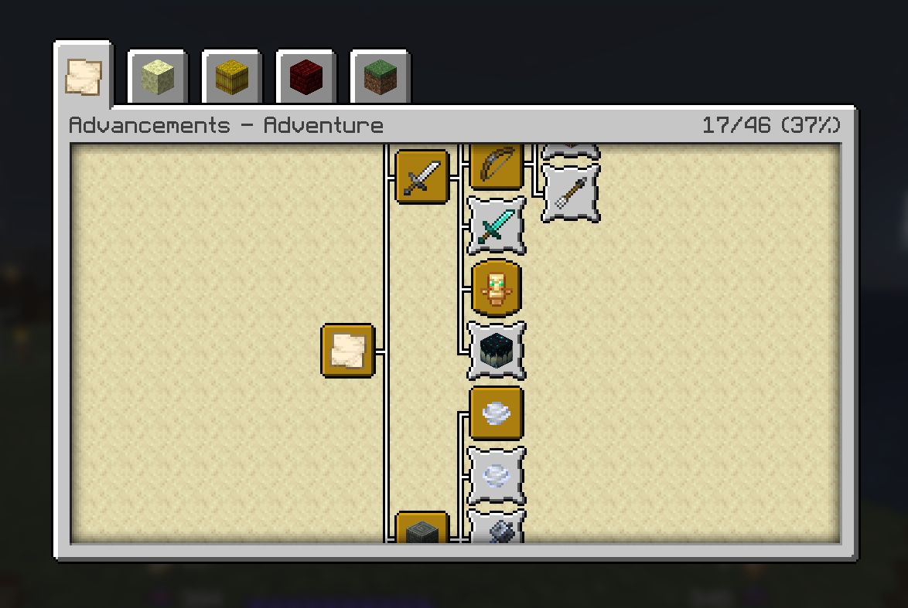
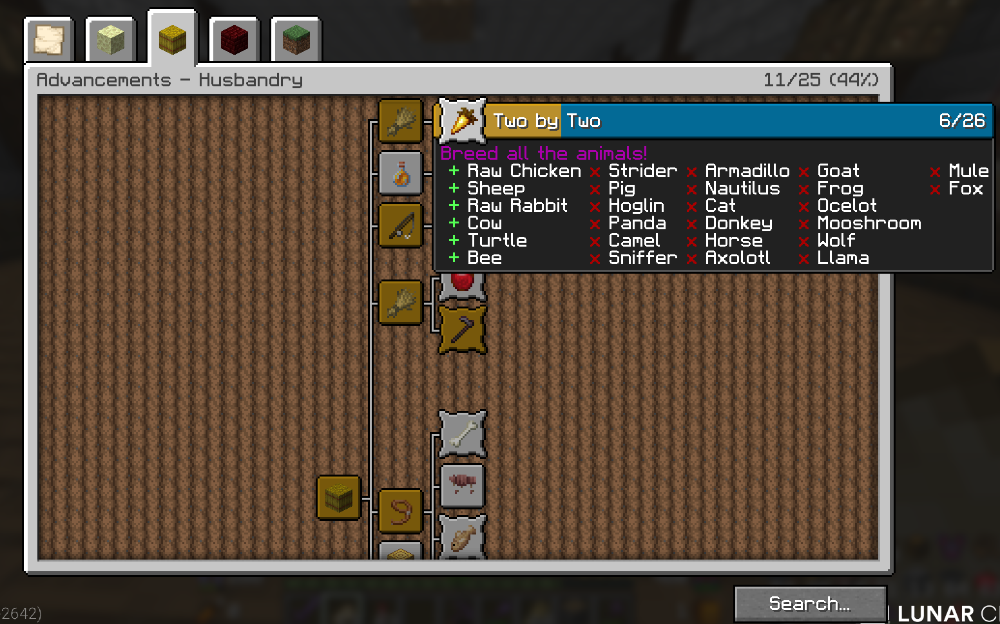
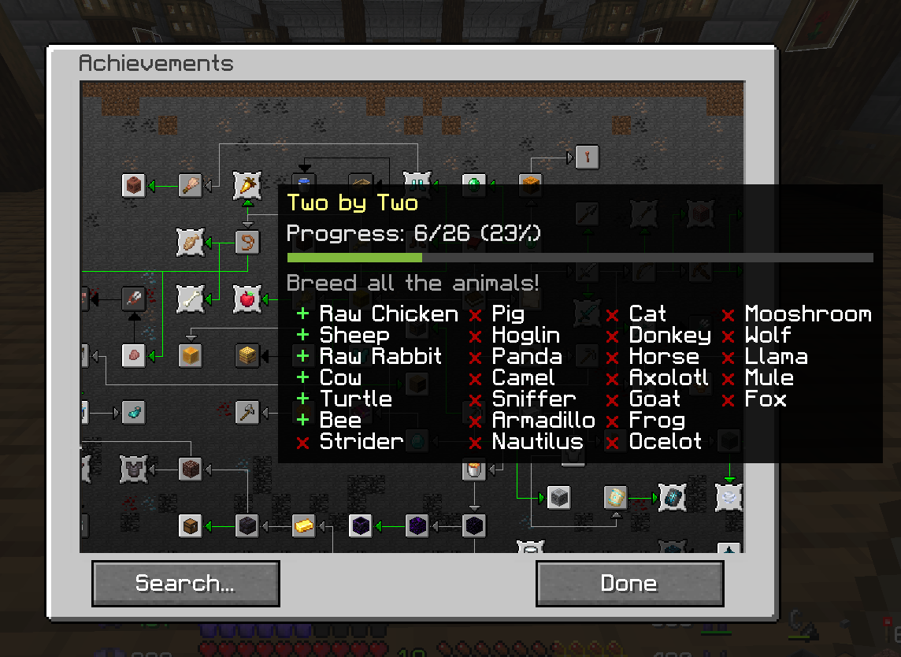
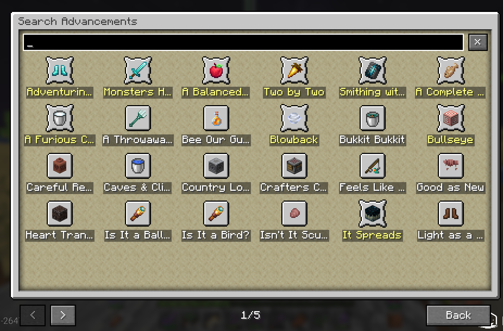
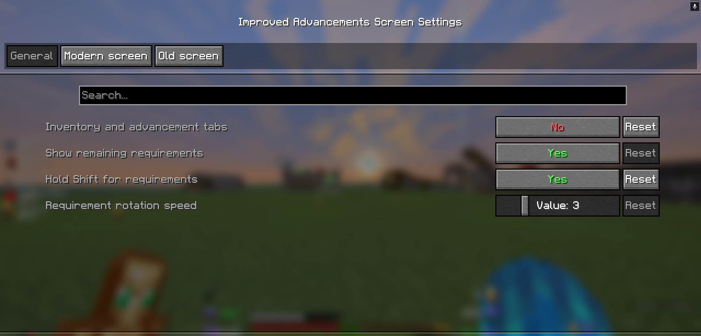

# Improved Advancements Screen

> Every requirement. Every milestone. A little nostalgia.

**Minecraft 26.3 · Fabric · Client-side, with optional server support**

Track progress with **counts and percentages**, return to your saved tab and map position, and keep advancement layouts consistent. Optional **diamond tabs** let you switch between your Survival inventory and advancements.

See completed and remaining requirements in advancement tooltips, where Minecraft provides that information. **Completed requirements come first, with missing ones at the end.**

Enable **Old screen** for an achievement map inspired by Minecraft before 1.12.

Explore modern advancements on **one draggable map**, with an underground background, prerequisite arrows, and nearby goals that appear as you progress.

Zoom with the mouse wheel and return to your saved position and zoom. Optional tooltips show **progress, a progress bar, and remaining requirements**.

Find your next goal by **name, description, or item**. Press **Ctrl+F** and select a result to jump to it. Search works in both views.

Choose an **online or previously joined player** and compare advancement progress in either screen. Hover over an advancement to see both players' progress, then hold **Ctrl** to reveal their requirement checklist when available.

**Player comparison requires the mod and Fabric API on both your client and the server.** All other features work client-side.

Adjust screen sizes, discovery distance, saved views, tooltips, inventory tabs, and player comparison through **Mod Menu**.

Enable Old screen through **Mods → Improved Advancements Screen → Configure → Old screen → Toggle**.

Install with **Fabric API**. Add **Mod Menu** and **Cloth Config** for configuration.

Minecraft still controls advancement completion and which requirement details reach your client.

---

Created by **Periklis20M** and **Johnfrag**. Licensed under [MIT](https://github.com/perikIis20M/Personalpicturesforprojectsperiklis20m/blob/main/improved-advancements-screen/credits/LICENSE-MIT.md).

Classic Minecraft artwork belongs to Mojang. Unofficial project; not affiliated with Mojang or Microsoft.
